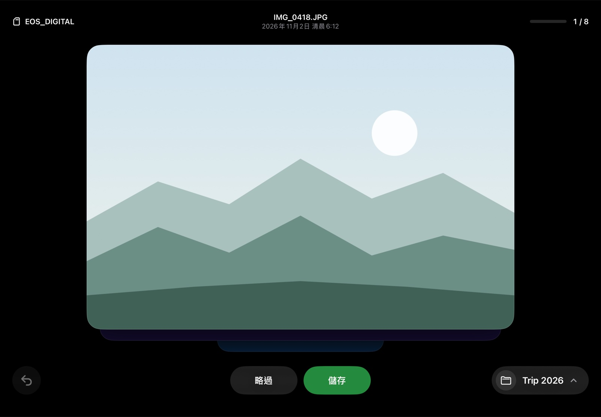
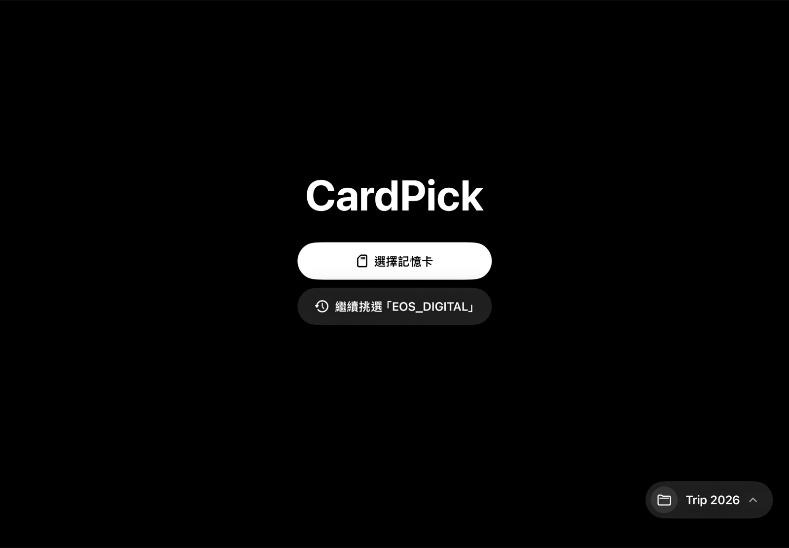
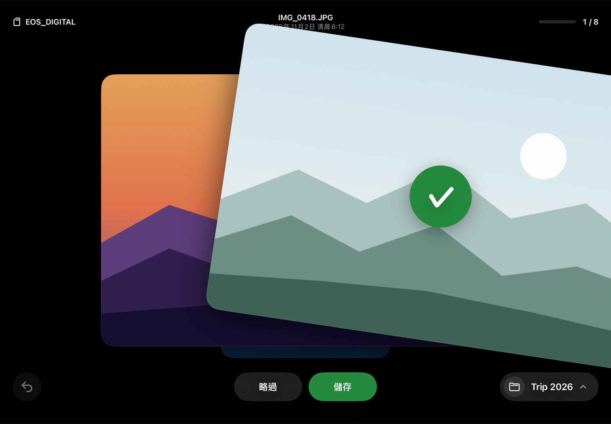
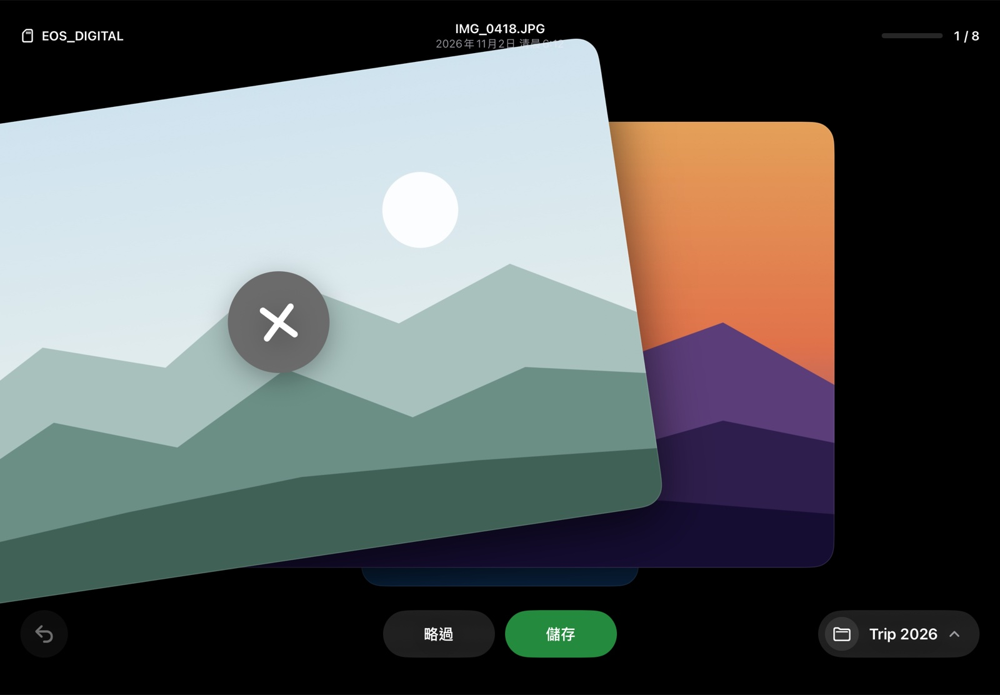
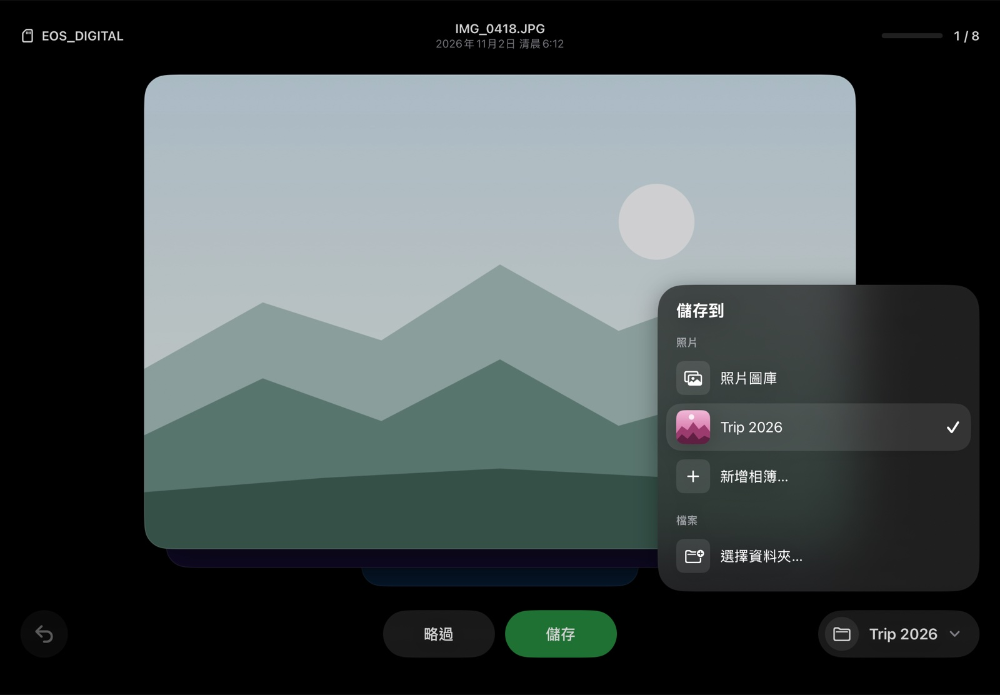
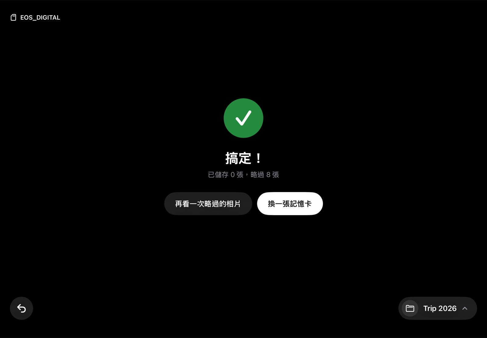
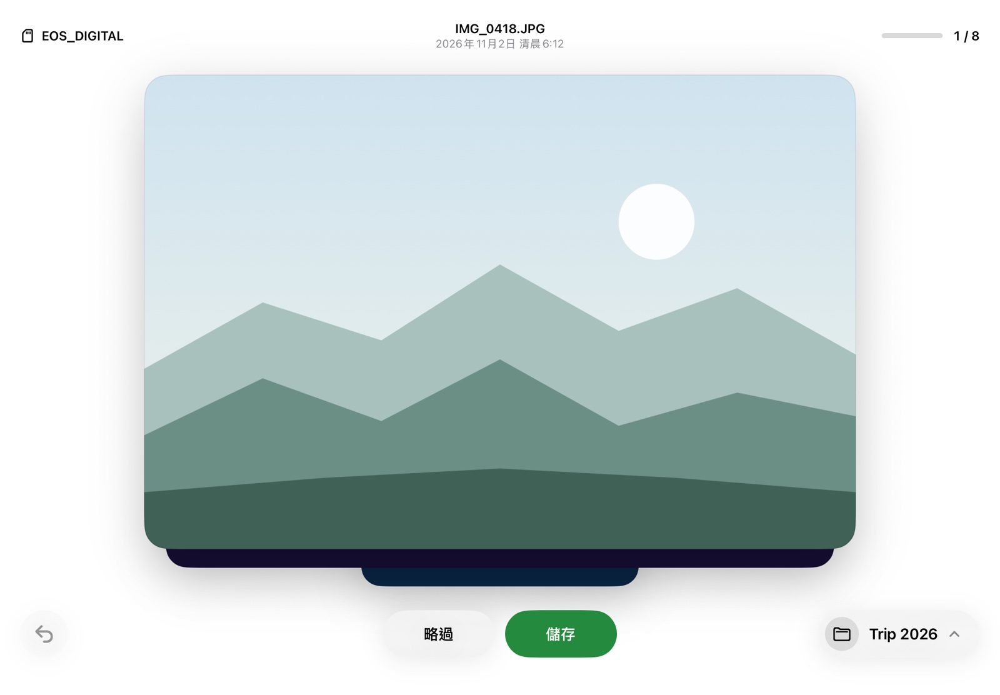

  

<h1 align="center">CardPick</h1>

像交友軟體一樣挑記憶卡裡的相片：左滑略過、右滑儲存。

## 下載

到 [Releases](https://github.com/PACO630/CardPick/releases/latest) 下載最新版的 `CardPick-v*.ipa`（未簽名），用 Sideloadly 或 AltStore 等工具以你的 Apple ID 簽名後安裝到 iPad。

## 功能介紹

### 連接記憶卡

用讀卡機把記憶卡接上 iPad，點「選擇記憶卡」，進到相片所在的資料夾（通常是 `DCIM/100XXXXX`），按「全選」或勾選要挑的相片，再按「打開」。

- 系統會先把勾選的相片複製進 CardPick 再開始挑選。iPadOS 16 直接讀取外接記憶卡上的檔案會一直轉圈，複製進來最穩定。複製時不會顯示進度，張數多時請稍等。
- 記憶卡上的原始檔案不會被改動或刪除。
- 會讀取 JPG、HEIC、PNG、TIFF 和各家相機的 RAW 檔。
- 同名的 RAW 和 JPG（例如 `IMG_0421.CR3` 與 `IMG_0421.JPG`）合成一張卡片，上方會標示「RAW+JPG」。
- 「繼續挑選」會回到上一批複製進來的相片，從還沒看過的那張接著挑。換下一張卡時，上一批複製的相片會自動刪掉，不會一直佔用空間。

### 左滑略過、右滑儲存

| 右滑：儲存 | 左滑：略過 |
| :---: | :---: |
|  |  |

- **右滑**：存到你選的位置，卡片中央出現綠色勾勾。
- **左滑**：略過，相片留在記憶卡上，卡片中央出現灰色叉叉。
- 也可以按下方的「略過」「儲存」按鈕。
- 上方顯示檔名、拍攝日期和進度。

### 復原

左下角的圓形按鈕可以復原上一步，次數不限，卡片會從滑走的方向飛回來。

右滑的相片會先記下來，等你回到開始畫面、換一張記憶卡，或切到別的 App 時，才一次存進去。所以挑選過程中怎麼復原都不會跳出刪除確認。如果 App 在存進去之前被關掉，下次「繼續挑選」這批相片時會自動補存。

### 儲存位置

點右下角的按鈕選擇右滑的相片要存到哪裡：

- **照片**：照片圖庫，或某個相簿（可以直接新增相簿）。RAW+JPG 會存成同一張照片，保留 RAW 原檔。
- **檔案**：「我的 iPad」或 iCloud 雲碟裡的任一資料夾，直接複製原始檔案。檔名重複時，RAW 和 JPG 會一起加上相同的編號。

### 搞定！

整張卡看完後會顯示存了幾張、略過幾張，可以「再看一次略過的相片」，或換一張記憶卡。

### 深色與淺色

背景是純黑或純白，跟著 iPad 的外觀設定自動切換。按鈕和面板使用毛玻璃。

### 觸控、滑鼠與觸控板操作

| 動作 | 觸控 | 觸控板 | 滑鼠 |
| --- | --- | --- | --- |
| 儲存 | 往右滑 | 雙指往右滑 | 按住往右拖 |
| 略過 | 往左滑 | 雙指往左滑 | 按住往左拖 |
| 其他操作 | 點按鈕 | 點按鈕 | 點按鈕 |

使用滑鼠或觸控板時，指標移到按鈕上會顯示 iPadOS 的懸停效果。

### 鍵盤快捷鍵

接上實體鍵盤（例如巧控鍵盤）就能用，按住 ⌘ 會列出所有快捷鍵：

| 按鍵 | 作用 |
| --- | --- |
| → | 儲存 |
| ← | 略過 |
| ⌘Z | 復原 |
| ⌘O | 選擇記憶卡 |
| ⌘D | 選擇儲存位置 |
| Esc | 關閉儲存位置面板 |

## 系統需求

- iPad，iPadOS 16.0 以上（針對 iPad Air 4 設計，其他尺寸也能使用）。
- 支援橫向與直向。
- 需要能讓 iPad 讀取記憶卡的讀卡機（USB-C 或 Lightning）。
- 編譯需要 Xcode 26 以上（專案使用 file-system synchronized groups）。

## 權限與隱私

| 權限 | 用途 |
| --- | --- |
| 照片（完整取用） | 把相片存進「照片」、列出相簿，以及復原時刪除剛存的相片 |

只有存到「照片」時才需要這個權限；存到「檔案」的資料夾不需要。

App 不會連網，沒有任何分析、廣告或帳號系統。挑選進度、設定和複製進來的相片只存在 iPad 本機。

## 聲明

本專案是個人作品，與 Apple Inc. 沒有任何關係，也未經 Apple 授權或背書。「iPad」、「iPadOS」等為 Apple Inc. 的商標。

作者：@paco._0630

## 授權

本專案以 [PolyForm Noncommercial License 1.0.0](LICENSE.md) 授權：可以免費使用、修改、分享，但不得用於商業用途。散布時請一併附上授權條款與 `Required Notice` 那一行。
